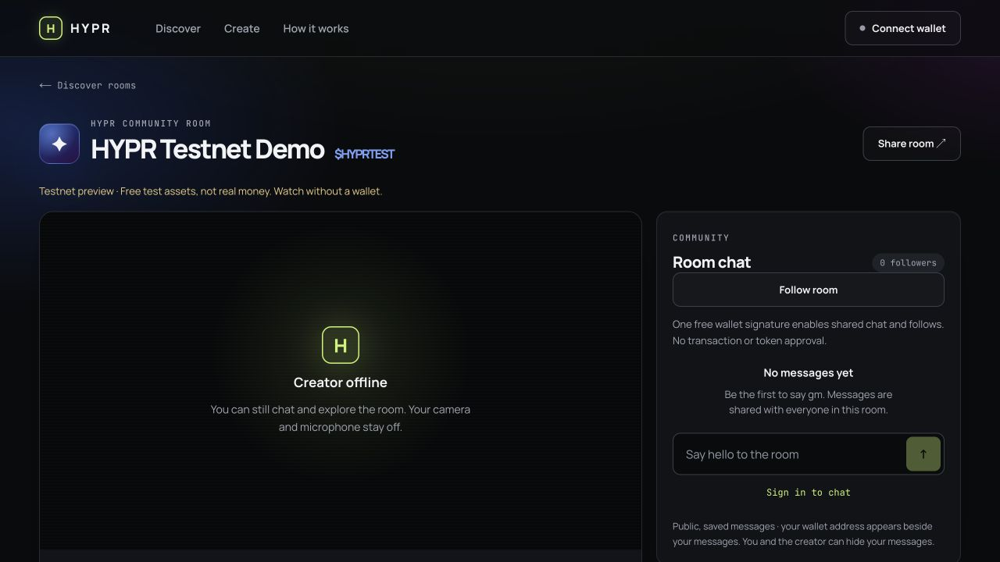
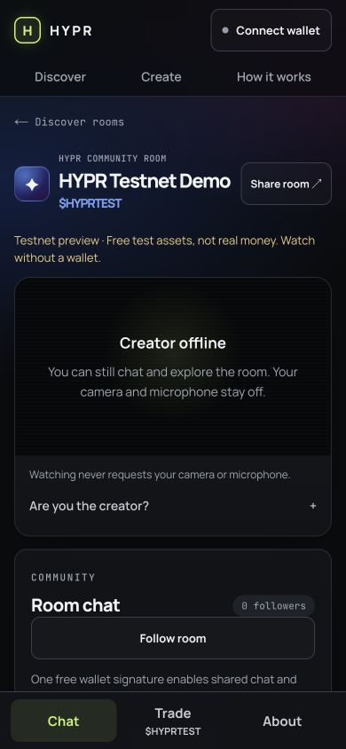

# HYPR — current product review guide

Prepared October 13, 2026 for Founder House Singapore screening and current
product review. This is a dated progress update, **not** a replacement for the
locked October 12 Crypto World's Fair submission or a claim that later work was
completed within that competition's entry period.

## What HYPR is

HYPR gives an onchain creator and community a persistent room attached to their
token launch. The Robinhood Chain testnet MVP combines fixed-supply creation,
transparent automatic-price trading, creator/protocol fee accounting, shared
wallet-authenticated chat/follows, and an in-room broadcast studio.

Watching an available broadcast and reading a room do not require a wallet or a
token purchase. Test tokens are not shares in HYPR, a claim on company income,
or a promise of returns. Test ETH has no real monetary value.

## Review links

- [Public app](https://hypr-pons.vercel.app)
- [Canonical HYPRTEST room](https://hypr-pons.vercel.app/room/0xeA3b5d2Cf6EAcD3dd6241736082b7698E519a675)
- [Public source](https://github.com/gulalabs1-droid/HYPR-PONS)
- [Founder pitch](https://youtu.be/tYT1xgGFwh8): original founder voice, no camera, about 1:56.
- [Historical product walkthrough](https://youtu.be/OlhpxJlsKdA): about 1:47; edited actual October 12 site screens and a historical receipt with system narration. It does not show the October 13 UI, a new transaction, or a completed broadcast.
- [Public transaction evidence](HYPR_CONTROLLED_DEMO.md)
- [Contract deployment/source evidence](HYPR_TESTNET_EVIDENCE.md)
- [Data, authentication and freshness boundaries](HYPR_LIVE_DATA.md)
- [Consumer UX and privacy changes](HYPR_CONSUMER_UX.md)

## Two-minute, wallet-free inspection

1. Open the canonical room. Check its real token/creator/chain attribution and
   explicit testnet label. An offline creator is shown as offline, not as a
   fabricated live stream. Browsing does not request camera/microphone access.
2. On desktop, inspect the player and chat side by side. On a phone-sized
   viewport, use Chat / Trade / About. Reading chat is public; writing/following
   requires a free wallet signature, not a coin transaction.
3. In Trade, select Buy and enter `0.001` test ETH to request a read-only quote.
   Open Review purchase to inspect the named token, included 1.25% trading fee,
   estimated output, 2% minimum-output limit and separate network fee. No wallet
   is needed for this review. Do not confirm a transaction just to inspect it.
4. Open About / Trading details for actual reserve, current fee balances,
   recent-window activity and progress toward the liquidity pool. Zero current
   fee balances are not lifetime revenue. Missing metrics are not invented.
5. Expand creator information to inspect the studio boundary. Opening the
   studio leaves both devices off; private preview and starting a broadcast
   require separate deliberate actions. Only the indexed creator can authorize
   publishing. This inspection does not prove media delivery.

## Fresh checks and evidence scope

Reviewed application-code release:
[`3614b50689385b633acf2d84248df749fec6d8c3`](https://github.com/gulalabs1-droid/HYPR-PONS/commit/3614b50689385b633acf2d84248df749fec6d8c3).

- [Main-branch Web and Foundry CI](https://github.com/gulalabs1-droid/HYPR-PONS/actions/runs/38438201060) completed successfully at that release.
- 87 web tests passed, along with typecheck, lint, production build and the
  client-bundle security scan. These are automated checks, not certification.
- Hosted runtime smoke freshly passed on October 13 with `native-rpc`.
- Robinhood RPC freshly returned chain `46630`; the six existing create, buy,
  exact approval, sell, creator-fee claim and protocol-fee claim receipts all
  returned successful status. No new blockchain transaction was sent.
- Shared authentication/message/follow behavior was previously checked on the
  published app with an ephemeral unfunded identity and independent public
  reader; its marked message was soft-hidden and follow undone. This is
  integration evidence, not independent-user traction.
- Desktop, 320/390px phone-sized and 768px tablet-sized layouts were inspected;
  no horizontal overflow was observed in the checked views. These are browser
  viewport checks, not real iPhone/Android hardware acceptance.
- Both existing Unlisted video links opened and playback advanced without
  player errors on October 13. Their contents remain historical recordings.

### Current production UI captures

Actual October 13 public-site captures. The offline label is intentional: no
creator media session was active. These are screenshots, not a live-video test.

## Known release gates — not completed claims

- Actual creator-to-viewer audio/video reception with an explicitly approved
  source. The founder requested preparation without personal camera/microphone;
  no personal media was captured, recorded or broadcast.
- Real iOS/Android wallet-browser, keyboard/orientation and novice usability
  acceptance. WalletConnect is not implemented; a mobile injected-wallet
  browser is currently required for wallet actions.
- Public-chain Uniswap v4 graduation. Graduation has local/fork proof, not a
  successful public-chain graduation transaction.
- Unattended full backfill/reorg operations, operational moderation and abuse
  monitoring, independent security/economics review, and representative load
  testing. No mainnet, million-user capacity, revenue or user-traction claim.

## Why Founder House / next milestone

The first audience is a small creator-led testnet pilot. The product hypothesis
is that a lasting room reduces fragmentation between launching, understanding
onchain state, and gathering as a community. No demand or retention result is
claimed before observation.

The proposed three-day plan is to validate one approved creator/viewer media
session, observe a small group completing the launch-to-room journey, and set a
measurable pilot/release plan with product and technical mentors. Useful metrics
include successful journey completion, time to first received media, repeat
visits, failure reports and streaming cost per viewer-minute. These are planned
measurements, not existing traction.

Consumer/social trading is a published Founder House area of interest. A
prototype is within the advertised application scope; selection and any
dedicated award eligibility remain the organizers' decisions. See the
[official application](https://luma.com/openhouse-singapore) and
[program announcement](https://blog.arbitrum.foundation/founder-house-singapore-apply-now-to-launch-products-on-arbitrum-one-robinhood-chain/).
